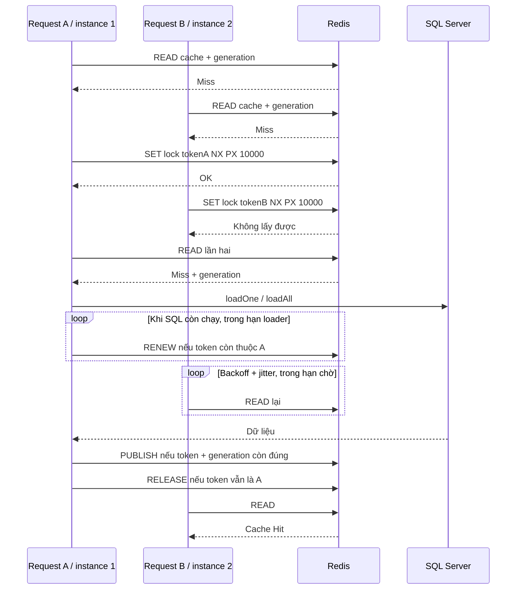

# Cache Stampede và Redis Distributed Lock

Redis Cache là bản sao dữ liệu để giảm truy vấn. Cache Stampede là hiện tượng nhiều request cùng miss (cache lạnh hoặc hết hạn), mỗi request lại SELECT SQL giống nhau. Distributed Lock phối hợp các instance để chọn một request nạp dữ liệu cho mỗi key.

Ví dụ 1.000 request GET `/detai/1` đồng thời: nếu chỉ GET/miss/SELECT/SET, có thể có tới 1.000 SELECT cùng dữ liệu, gây chờ pool SQL và tăng độ trễ. Có lock, thông thường một request SELECT, các request còn lại chờ dữ liệu. Đây là minh họa cơ chế, **không phải số đo tải thật**. Nếu query kéo dài, lock mất, process chết hoặc request hết ngân sách, không bảo đảm mọi request đều 200 hay tổng SELECT luôn đúng một.

| Trường hợp | Không lock | Triển khai hiện tại |
| --- | --- | --- |
| Cùng key đang miss | Nhiều SELECT trùng | Một holder mỗi lease, request khác poll Redis |
| Khác key | Song song | Vẫn song song |
| Chờ quá lâu | Dễ dồn sang SQL | 503, không fallback SQL |
| Nhiều process | Local mutex không phối hợp | Redis dùng chung phối hợp token/lease |



## Code chống Cache Stampede nằm ở đâu?

| Yêu cầu nghiệp vụ | File code | Hàm | Cơ chế hoạt động |
| --- | --- | --- | --- |
| Kiểm tra cache | `shared/cache/src/index.ts` | `CacheService.read`, `remember` | Lua READ lấy generation và payload nguyên tử |
| Giành lock riêng key | `shared/cache/src/index.ts` | `CacheService.remember` | UUID mới mỗi lần, SET NX PX |
| Kiểm tra cache lần hai | `shared/cache/src/index.ts` | `CacheService.remember` | READ sau khi lấy lock, tránh SELECT không cần thiết |
| SELECT sinh viên | `svc-sinhvien/src/app.service.ts` | `AppService.loadOne`, `loadAll` | Callback chỉ chạy khi miss dưới lock |
| SELECT đề tài | `svc-detai/src/app.service.ts` | `AppService.loadOne`, `loadAll` | Callback tương tự |
| Chờ cache | `shared/cache/src/index.ts` | `CacheService.remember` | Vòng lặp deadline + retry, delay backoff/jitter |
| Gia hạn lease | `shared/cache/src/index.ts`, `shared/cache/src/scripts.ts` | Callback `renew`, `RENEW` | So token rồi PEXPIRE nguyên tử |
| Chống stale publish | `shared/cache/src/scripts.ts` | `PUBLISH` | So token và generation trước SET PX |
| Unlock | `shared/cache/src/index.ts`, `shared/cache/src/scripts.ts` | Khối finally của `remember`, `RELEASE` | So token và DEL nguyên tử |
| Writer làm mới dữ liệu | Hai file `app.service.ts` nêu trên | `create`, `update`, `remove` | Gọi `CacheService.invalidate` sau ghi SQL |
| Lỗi Redis | `shared/cache/src/index.ts` | `CacheService.command` | 503, không gọi SQL thay thế |

Các đoạn dưới trích từ code triển khai, không phải mã giả.

Kiểm tra cache trong `remember`:

```ts
const [, cached] = await this.read(key, generationKey);
if (cached !== null) {
  this.logger.debug(`CACHE_HIT ${scope}:${kind}`);
  return JSON.parse(cached) as T;
}
```

Lấy lock trong cùng hàm:

```ts
const token = randomUUID();
const acquired = await this.command(() => this.client.set(lockKey, token, 'PX', this.options.lockMs, 'NX'));
```

`NX` chỉ ghi khi chưa có key, `PX` đặt thời gian sống mili giây. Cả hai áp dụng trong một SET nguyên tử. UUID phân biệt holder mới và cũ, không dùng chung token giữa request. Token không xuất hiện trong log.

Sau lấy lock, `remember` đọc cache lần hai rồi gọi callback SQL:

```ts
const [generation, second] = await this.read(key, generationKey);
if (second !== null) return JSON.parse(second) as T;
this.logger.debug(`CACHE_LOAD ${scope}:${kind}`);
// Business errors propagate unchanged, including SQL errors and 404.
const value = await loader();
```

Vị trí gọi từ sinh viên: `AppService.findOne` dùng `this.cache.remember('sinhvien', String(maSV), 'detail', () => this.loadOne(maSV))`. Đề tài dùng `'detai'` và `maDT`. `findAll` dùng resource `'all'`, kind `'list'`. Constructor nhận CacheService từ RedisModule trong AppModule.

Request không lấy lock cần chờ để dùng kết quả holder. Cuối vòng lặp `remember`:

```ts
const remaining = deadline - Date.now();
if (remaining > 0) await delay(Math.min(remaining, 20 * 2 ** Math.min(attempt, 3) + Math.random() * 30));
```

Backoff cơ bản 20, 40, 80, rồi 160 ms, cộng jitter dưới 30 ms. Giới hạn mặc định 30 lượt và 2 giây chờ, mỗi lệnh Redis timeout 500 ms. Ngân sách chờ kiểm tra giữa các lệnh, nên thời gian thực có thể vượt deadline bởi lệnh đang chạy; deadline không hủy SELECT của holder. Gateway timeout 5 giây hiện có không bị thay đổi.

Publish nguyên tử trong `shared/cache/src/scripts.ts`:

```lua
if redis.call('GET', KEYS[2]) ~= ARGV[1] then return 0 end
if (redis.call('GET', KEYS[3]) or '0') ~= ARGV[2] then return 0 end
redis.call('SET', KEYS[1], ARGV[3], 'PX', ARGV[4])
return 1
```

Nếu token hoặc generation đổi, không ghi và không trả kết quả SELECT cũ; `remember` thử lại trong ngân sách. Generation tăng bởi writer giúp chống tình huống SELECT đang chạy lúc UPDATE commit.

Unlock trong `finally` luôn chạy cả khi loader ném SQL error/404. Lua RELEASE:

```lua
if redis.call('GET', KEYS[1]) == ARGV[1] then return redis.call('DEL', KEYS[1]) end
return 0
```

Không dùng GET rồi DEL rời nhau, vì holder mới có thể xuất hiện giữa hai lệnh. Khi Redis lỗi lúc unlock, log `LOCK_RELEASE_FAILED` và để TTL thu hồi; lỗi nghiệp vụ ban đầu không bị thay thế bởi lỗi unlock.

## Lease, lỗi và giới hạn

- Gia hạn mỗi `lockMs/3` bằng callback `renew`, so token nguyên tử. Callback không chồng lấn: chỉ đặt timer mới sau lần renew trước hoàn tất. Dừng timer trong finally. Lease mặc định 10 giây; hết hạn gia hạn/publish sau 35 giây để loader treo không giữ lock mãi. SQL hiện có requestTimeout 30 giây.
- Nếu renew thất bại hoặc mất token, đánh dấu lost; không publish dữ liệu loader. PUBLISH còn kiểm tra token độc lập, bảo vệ cả trường hợp event loop bị đứng khiến timer chưa kịp chạy.
- Lock TTL xử lý process bị kill. Instance khác có thể thử lấy lease sau khi hết hạn. Nếu chủ cũ chưa dừng SELECT thì **có thể có SELECT trùng** sau mất lease; token chỉ ngăn publish/unlock sai, không hủy SQL trên instance cũ. Đây là khóa chống tải trùng thông thường, không phải khóa giao dịch nghiệp vụ hoặc cơ chế exactly-once.
- Không có local single-flight trong bản này. Local single-flight chỉ gộp Promise trong một process; distributed lock phối hợp nhiều process. Test dùng 100 CacheService độc lập chia sẻ một Redis giả lập để không dựa vào gộp Promise local. Redis thật có test hai client độc lập.
- Cache hết hạn trở về miss và cạnh tranh lock như cache lạnh. Không cache 404, nên nhiều request liên tục vào ID không tồn tại có thể lần lượt SELECT; không có negative caching.
- Redis unavailable: trả 503 cho đọc, không bypass SQL; Redis reconnect với delay tăng tối đa 2 giây. Offline queue tắt, không tự phát lại lệnh ghi cũ sau phục hồi. Holder đã SELECT xong nhưng publish Redis lỗi cũng có thể nhận 503. Lỗi SQL/404 từ loader vẫn truyền nguyên vẹn.
- Hết thời gian chờ: 503, không có đợt fallback SQL đồng loạt. Client cần retry có backoff/jitter, không retry nóng.
- Invalidation thất bại sau SQL commit: log riêng, giữ kết quả ghi thành công; cửa sổ stale còn tồn tại, xem [giới hạn nhất quán](redis-cache.md). Không cam kết cache nhất quán mạnh khi mất Redis hoặc process chết.
- Chỉ hỗ trợ **Redis standalone** cho các Lua nhiều key hiện tại. Redis Cluster cần hash tags/key layout khác. Replica failover hoặc Redis restart làm mất lock có thể tạo holder trùng; không tuyên bố đây là Redlock hoặc bảo đảm consensus.
- Không chặn tổng số key khác nhau đang tải. Mỗi key có lock riêng; nhiều ID khác nhau vẫn có thể gây tải SQL. Cần rate limit/admission control riêng nếu vận hành quy mô lớn.
- Không phục vụ stale-while-revalidate. Hit vẫn cần Redis, vì vậy Redis là dependency của luồng đọc; health hiện có chỉ đo SQL như trước, không dùng nó làm bằng chứng cache sẵn sàng.

Tham khảo nguyên lý [SET NX PX và token unlock của Redis](https://redis.io/docs/latest/develop/clients/patterns/distributed-locks/). Cách chạy và giới hạn đo thực tế nằm trong [redis-testing.md](redis-testing.md).
