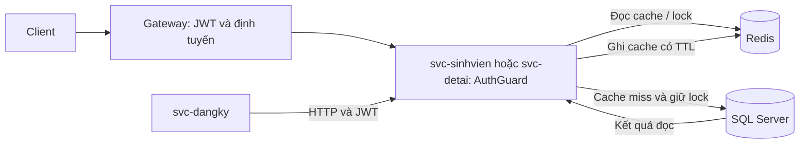

# Redis Cache trong hệ thống quản lý đồ án

Redis lưu bản sao dữ liệu đọc thường xuyên trong bộ nhớ, giảm số lần gọi SQL Server. SQL Server vẫn là nguồn dữ liệu chính, thực hiện ghi và ràng buộc nghiệp vụ; Redis có thể mất toàn bộ dữ liệu mà không làm mất sinh viên hay đề tài. Giải pháp dùng Cache-Aside: chỉ nạp cache khi có người đọc.

Cache nằm **bên trong svc-sinhvien và svc-detai**, sau controller/guard. Đây là hai nguồn dữ liệu được frontend và svc-dangky cùng tra cứu. Không cache JWT, mật khẩu hay nghiệp vụ ghi đăng ký. Gateway, Auth, role, DTO, câu SQL và HTTP giữa các service được giữ nguyên. Cache chỉ chứa các cột đang SELECT, gồm thông tin hồ sơ sinh viên (cần bảo vệ quyền truy cập Redis) và đề tài.



## Luồng đọc

1. Gateway chuyển request, guard của service kiểm tra JWT và role như trước.
2. `AppService.findOne` hoặc `findAll` gọi `CacheService.remember`.
3. `read` chạy Lua `READ`: đọc generation hiện tại và dữ liệu bằng `GET` trong cùng thao tác nguyên tử. Chỉ trả cache nếu generation khớp. Hit trả payload JSON, không gọi SQL.
4. Miss lấy lock riêng của key, đọc cache lần nữa, rồi gọi callback `loadOne`/`loadAll` nếu vẫn miss.
5. Lua `PUBLISH` chỉ SET khi token lock và generation còn đúng. Kết quả giữ nguyên cấu trúc response cũ.
6. Không cache exception, bao gồm 404. Dữ liệu rỗng của danh sách vẫn được cache.

## Key và TTL

Prefix mặc định `soa:`; đặt prefix khác cho từng môi trường. Tất cả instance của cùng môi trường phải dùng cùng Redis, prefix và cấu hình. Đề tài dùng ID **số**, ví dụ `1`, theo controller hiện có; không dùng `DT001`.

| Key thực tế mặc định | Nội dung | TTL mặc định |
| --- | --- | --- |
| `soa:sinhvien:detail:SV001` | Một hồ sơ | 60–dưới 65 giây |
| `soa:sinhvien:list:all` | Danh sách sinh viên | 30–dưới 35 giây |
| `soa:detai:detail:1` | Một đề tài | 60–dưới 65 giây |
| `soa:detai:list:all` | Danh sách đề tài | 30–dưới 35 giây |
| `<key dữ liệu>:lock` | Token UUID của loader | 10 giây, gia hạn mỗi khoảng 3,33 giây |
| `soa:sinhvien:generation` | Phiên bản cache sinh viên | Không hết hạn |
| `soa:detai:generation` | Phiên bản cache đề tài | Không hết hạn |

Giá trị dữ liệu là envelope `{generation, payload}`; `payload` là chuỗi JSON của response đọc, envelope không gửi ra HTTP. Hai generation key cố định, không tạo version key cho mỗi ID. Không tự xóa riêng generation key khi dữ liệu cache còn tồn tại. Redis cần dùng `noeviction` để tránh generation bị loại bỏ riêng; khi đầy bộ nhớ có thể trả 503 và cần xử lý dung lượng.

## Redis Cache được triển khai tại đâu trong mã nguồn?

| File | Class/Hàm | Chức năng | Giải thích |
| --- | --- | --- | --- |
| `shared/cache/src/index.ts` | `CacheService.constructor` | Tạo và kết nối ioredis | Đọc REDIS_URL, giới hạn thời gian lệnh, tắt offline queue, tự reconnect |
| `shared/cache/src/index.ts` | `cacheOptions` | Cấu hình | Kiểm tra số nguyên dương; jitter có thể bằng 0 |
| `shared/cache/src/index.ts` | `CacheService.read`, `remember` | Cache-Aside | Gọi READ; lock, callback SQL, PUBLISH |
| `shared/cache/src/index.ts` | `CacheService.invalidate` | Invalidation | Tăng generation và xóa detail/list sau ghi SQL |
| `shared/cache/src/index.ts` | `CacheService.command`, `onModuleDestroy` | Xử lý kết nối | Chuyển lỗi Redis thành 503; đóng client khi shutdown |
| `shared/cache/src/index.ts` | `RedisModule` | Nest DI | Factory tạo CacheService và export provider |
| `shared/cache/src/scripts.ts` | `READ`, `PUBLISH`, `INVALIDATE`, `RENEW`, `RELEASE` | Lua nguyên tử | GET, SET PX, INCR/DEL, gia hạn và unlock có so token |
| `svc-sinhvien/src/app.service.ts` | `AppService.findOne`, `findAll`, `loadOne`, `loadAll` | Đọc sinh viên | Hai hàm public gọi cache; hai hàm private chạy SQL cũ |
| `svc-detai/src/app.service.ts` | `AppService.findOne`, `findAll`, `loadOne`, `loadAll` | Đọc đề tài | Cùng cơ chế, namespace detai |
| `svc-sinhvien/src/app.service.ts` | `AppService.create`, `update`, `remove` | Ghi sinh viên | Invalidate sau ghi thành công; create vẫn tạo tài khoản qua Auth |
| `svc-detai/src/app.service.ts` | `AppService.create`, `update`, `remove` | Ghi đề tài | Invalidate sau ghi thành công |
| `svc-sinhvien/src/app.module.ts`, `svc-detai/src/app.module.ts` | `AppModule` | Đăng ký module | Import RedisModule; constructor AppService nhận CacheService |
| `shared/cache/package.json`, `shared/cache/package-lock.json`, `shared/cache/tsconfig.json` | Scripts/package | Gói ESM dùng chung | Build TypeScript, Vitest, lint và ioredis |
| `svc-sinhvien/package.json`, `svc-sinhvien/package-lock.json`, `svc-detai/package.json`, `svc-detai/package-lock.json` | Dependencies | Liên kết gói | `file:../shared/cache` |
| `.env.example`, `svc-sinhvien/.env.example`, `svc-detai/.env.example` | Biến môi trường | Cấu hình | Service kế thừa `.env` gốc, có thể ghi đè tại service |
| `scripts/redis-load.js` | Hàm mặc định k6 | Tải đồng thời | 100 virtual users, JWT lấy từ môi trường |
| `shared/cache/test/fake-redis.ts`, `shared/cache/test/cache.spec.ts` | `FakeRedis`, bộ test cache | Kiểm thử thuật toán | Không giả định đây là kiểm chứng Lua thật |
| `shared/cache/test/redis.integration.spec.ts` | Bộ test Real Redis | Kiểm chứng Lua và client | Chạy khi có REDIS_TEST_URL |
| `svc-sinhvien/src/app.service.spec.ts`, `svc-detai/src/cache.spec.ts` | Bộ test CRUD/cache | Kiểm thử điểm tích hợp | SQL giả lập và cache giả lập |
| `svc-detai/src/app.service.spec.ts` | Bộ test Topic CRUD | Bổ sung dependency cache | Giữ kiểm thử SQL và 404 cũ |
| `svc-sinhvien/test/app.e2e-spec.ts`, `svc-detai/test/auth.e2e-spec.ts` | Bộ test HTTP | Cô lập Redis | Override CacheService; kiểm tra JWT, role, DTO, route |
| `docs/redis-cache.md`, `docs/cache-stampede.md`, `docs/redis-testing.md`, `README.md` | Tài liệu | Hướng dẫn | Thiết kế, giới hạn, vận hành và demo |

Đoạn thực tế trong `svc-detai/src/app.service.ts`:

```ts
async findOne(maDT: number) {
  return this.cache.remember('detai', String(maDT), 'detail', () => this.loadOne(maDT));
}
```

`remember` chưa gọi callback khi có cache. Khi đã giành lock và cache vẫn miss, callback chạy hàm `loadOne`, chứa SELECT hiện có và NotFoundException hiện có. `svc-sinhvien` dùng cùng cách với `maSV`.

## Invalidation khi CRUD và race condition

Sau INSERT/UPDATE/DELETE thành công, `invalidate` chạy `INVALIDATE` nguyên tử: INCR generation của service, DEL detail liên quan và list. Các detail khác vẫn tồn tại vật lý tới TTL nhưng không còn hợp lệ vì generation không khớp. Đây là invalidation rộng có chủ ý: đơn giản, không dùng KEYS, và an toàn hơn với SQL collation không phân biệt hoa/thường/dấu hoặc khoảng trắng cuối mã sinh viên. Đổi lại, ghi một bản ghi khiến những detail khác phải nạp lại.

Loader chụp generation **trước SELECT**. Nếu một writer commit và invalidate trong khi SELECT đang chạy, Lua PUBLISH từ chối generation cũ. Loader giải phóng lock, thử đọc lại trong ngân sách còn lại hoặc trả 503. Nếu loader đã publish trước invalidate thì writer xóa/vô hiệu hóa kết quả đó. Không trả kết quả loader đã bị từ chối publish.

Sinh viên create gọi `loadOne` trực tiếp sau INSERT/invalidate để tạo response ghi như cũ, tránh phụ thuộc cache lúc vừa tạo tài khoản thành công. Nó không nạp cache; lần GET kế tiếp sẽ nạp.

**Giới hạn nhất quán:** SQL commit và Redis invalidate không cùng transaction. Nếu process chết giữa hai bước, hoặc Redis lỗi khi invalidate, cache cũ có thể còn tới TTL (mặc định tối đa gần 65 giây). Writer vẫn trả kết quả SQL thành công và log `CACHE_INVALIDATION_FAILED`, tránh báo lỗi ghi rồi khiến client tạo tài khoản lại. Một loader đang chạy trong sự cố có thể kéo dài cửa sổ stale thêm thời gian SELECT rồi TTL; không có bảo đảm nhất quán mạnh. Muốn loại bỏ khoảng trống này cần transactional outbox/CDC và cơ chế phát lại invalidation, ngoài phạm vi bản này. Không cấu hình TTL rất dài. Các thay đổi trực tiếp bằng SQL cũng chỉ được thấy sau TTL nếu không phát invalidation.

## Khởi chạy trên Windows

Dự án không sử dụng Docker. NestJS và SQL Server tiếp tục chạy trên Windows; Redis có thể chạy trực tiếp trong WSL/Ubuntu hoặc trên máy chủ Redis có sẵn. Hướng dẫn WSL tham khảo [Microsoft Learn](https://learn.microsoft.com/en-us/windows/wsl/tutorials/wsl-database).

Nếu đã có Redis, chỉ cần đặt `REDIS_URL` đúng địa chỉ và bảo đảm cấu hình `maxmemory-policy noeviction`; bỏ qua bước cài đặt. Với máy chưa có WSL, chạy PowerShell bằng quyền Administrator:

```powershell
wsl --install -d Ubuntu
```

Khởi động lại Windows nếu được yêu cầu, mở Ubuntu và tạo tài khoản Linux. Trong terminal Ubuntu:

```bash
sudo apt update
sudo apt install redis-server redis-tools
sudo nano /etc/redis/redis.conf
```

Trong file cấu hình, chỉnh các mục tương ứng cho Redis demo riêng (không thêm dòng trùng với cấu hình hiện có):

```conf
bind 127.0.0.1 ::1
protected-mode yes
port 6379
maxmemory 128mb
maxmemory-policy noeviction
save ""
appendonly no
```

Tắt persistence phù hợp cho cache demo riêng; không áp dụng tùy tiện cho Redis đang chứa dữ liệu của ứng dụng khác. Sau khi lưu cấu hình, chạy `sudo service redis-server restart` trong Ubuntu. Các lệnh dưới chạy ở PowerShell tại gốc repository, với tên distro `Ubuntu` (kiểm tra tên bằng `wsl -l -v`):

```powershell
wsl -d Ubuntu sudo service redis-server start
wsl -d Ubuntu redis-cli PING
npm.cmd ci --prefix shared/cache
npm.cmd ci --prefix svc-sinhvien
npm.cmd ci --prefix svc-detai
```

Không chạy `Copy-Item` đè `.env` đang có. Nếu chưa có, sao chép mẫu tương ứng rồi điền DB/JWT theo [hướng dẫn triển khai](HUONG-DAN-TRIEN-KHAI.md). Thêm các dòng Redis/CACHE trong `.env.example` vào `.env` gốc. Dùng `REDIS_URL=redis://127.0.0.1:6379` với Redis local; kiểm tra từ Windows bằng `Test-NetConnection 127.0.0.1 -Port 6379`. Nếu dùng Redis trên máy chủ khác, đặt URL theo địa chỉ, TLS và xác thực của máy chủ đó. Không commit URL có mật khẩu. Các ví dụ `wsl -d Ubuntu redis-cli` bên dưới dành cho Redis local; với Redis từ xa, dùng redis-cli kết nối đúng máy chủ.

| Biến | Mặc định | Ý nghĩa |
| --- | --- | --- |
| `REDIS_URL` | `redis://127.0.0.1:6379` | URL Redis; production có thể dùng `rediss://` và ACL |
| `REDIS_KEY_PREFIX` | `soa:` | Tách môi trường |
| `REDIS_COMMAND_TIMEOUT_MS` | 500 | Timeout kết nối và lệnh; offline queue bị tắt |
| `CACHE_DETAIL_TTL_MS` | 60000 | TTL detail |
| `CACHE_LIST_TTL_MS` | 30000 | TTL list |
| `CACHE_JITTER_MS` | 5000 | Cộng số mili giây ngẫu nhiên từ 0 tới nhỏ hơn giá trị này |
| `CACHE_LOCK_MS` | 10000 | Lease lock; tối thiểu 300 ms |
| `CACHE_WAIT_MS` | 2000 | Ngân sách chờ cạnh tranh lock, không phải timeout SELECT |
| `CACHE_RETRIES` | 30 | Số lượt đọc/lấy lock tối đa |
| `CACHE_MAX_LOAD_MS` | 35000 | Hạn gia hạn/publish của loader; SQL hiện timeout 30 giây |

Mở từng terminal riêng, chạy tại gốc:

```powershell
npm.cmd --prefix svc-auth run start:dev
npm.cmd --prefix svc-sinhvien run start:dev
npm.cmd --prefix svc-detai run start:dev
npm.cmd --prefix svc-dangky run start:dev
npm.cmd --prefix gateway run start:dev
```

Mỗi dòng chạy trong terminal riêng. Các service còn lại cần cài dependencies và cấu hình theo hướng dẫn triển khai nếu máy mới. Gói shared/cache tự build qua `prepare` khi cài; sau sửa gói, chạy `npm.cmd run build --prefix shared/cache` rồi restart hai service.

## Quan sát bằng Postman, curl và redis-cli

Đăng nhập như [tài liệu API](API.md), lấy JWT admin hợp lệ. Postman chọn Bearer Token, gọi GET `http://localhost:3000/detai/1` hai lần; dùng ID có thật. Hoặc:

```powershell
$env:DEMO_TOKEN = Read-Host 'JWT admin'
curl.exe -H "Authorization: Bearer $env:DEMO_TOKEN" http://localhost:3000/detai/1
curl.exe -H "Authorization: Bearer $env:DEMO_TOKEN" http://localhost:3000/detai/1
wsl -d Ubuntu redis-cli --scan --pattern 'soa:*'
wsl -d Ubuntu redis-cli GET soa:detai:detail:1
wsl -d Ubuntu redis-cli PTTL soa:detai:detail:1
```

Log `CACHE_MISS`, `LOCK_ACQUIRED`, `CACHE_LOAD` ở lần đầu, `CACHE_HIT` ở lần sau. `CACHE_LOAD` ngay trước callback SQL đọc, không đếm SQL ghi/health. Log chỉ chứa namespace/loại dữ liệu, không chứa ID, token, JWT, hồ sơ, URL hoặc mật khẩu. Nest mặc định có debug log; nếu tùy chỉnh logger phải bật mức debug để quan sát. PTTL trả mili giây; -2 là key không tồn tại, -1 là không đặt TTL (đúng với generation).

## Sự cố thường gặp

- WSL báo không tìm thấy Ubuntu: kiểm tra `wsl -l -v`, dùng đúng tên distro đã cài. Nếu PING trong WSL đạt nhưng Windows không kết nối cổng 6379, kiểm tra chuyển tiếp localhost của WSL và firewall; không mở Redis công khai để xử lý lỗi kết nối local.
- `REDIS_UNAVAILABLE`/503: kiểm tra PING, REDIS_URL, cổng 6379, firewall, mật khẩu/ACL. Không in URL thật vào log. Cache tự reconnect; request trong thời gian chưa ready có thể 503.
- `CACHE_INVALIDATION_FAILED`: SQL đã commit; không tự lặp lại POST. Khôi phục Redis, chờ TTL hết hoặc dọn các key của môi trường demo có kiểm soát.
- `LOCK_WAIT` rồi 503: kiểm tra độ chậm SQL, lock TTL và event loop. Không tăng retry vô hạn. Client retry có backoff/jitter.
- Redis đầy bộ nhớ: tăng giới hạn/giảm TTL, kiểm tra key bằng SCAN; không đổi sang chính sách có thể đẩy generation key ra ngoài một cách tùy tiện.
- PowerShell chặn npm.ps1: dùng `npm.cmd`, không cần đổi ExecutionPolicy.

Thiết kế token lock theo [hướng dẫn Redis](https://redis.io/docs/latest/develop/clients/patterns/distributed-locks/); cấu hình client tham khảo [ioredis](https://github.com/redis/ioredis). Xem tiếp [chống stampede](cache-stampede.md) và [kiểm thử](redis-testing.md).
